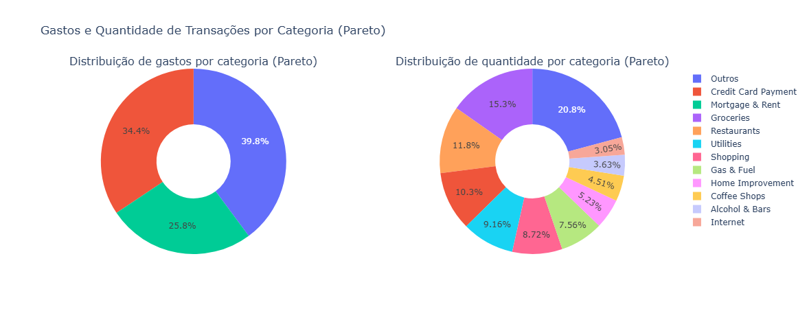
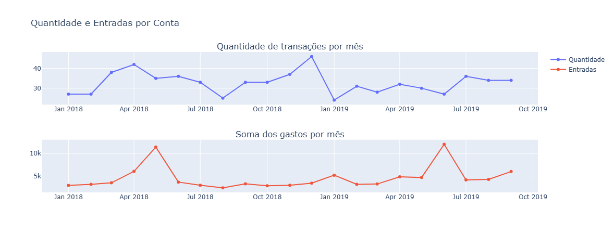
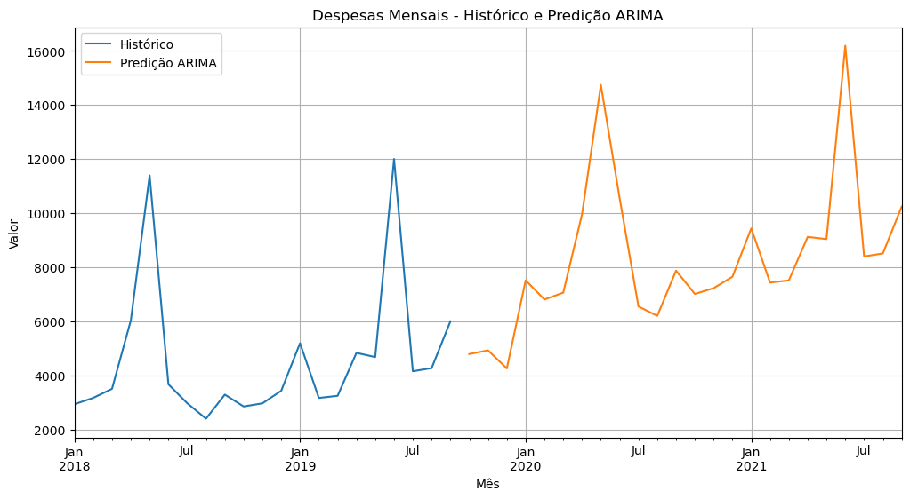
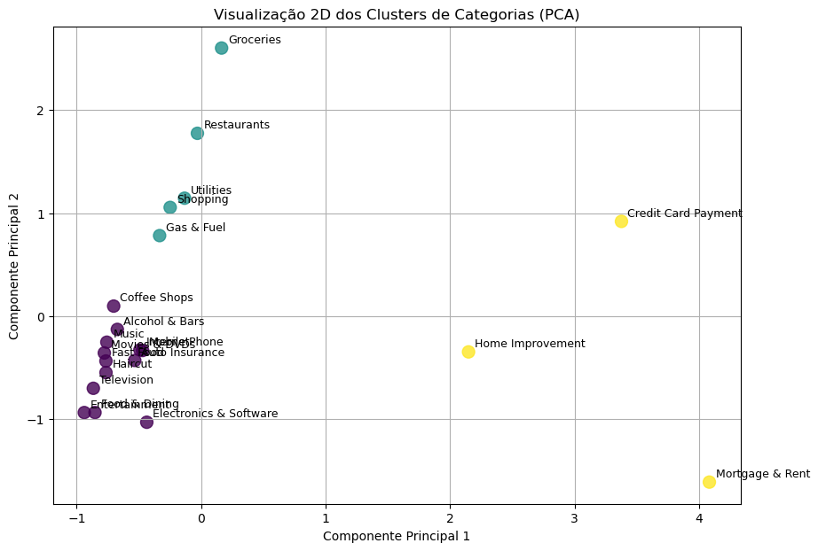

# Finanças pessoais: análise, previsão e segmentação de gastos

Estudo de ponta a ponta sobre um histórico de transações pessoais: de onde vem e para onde vai o dinheiro, como os gastos se comportam no tempo, quanto se deve gastar nos próximos meses e quais grupos de despesas pedem ações diferentes.

> **Dados:** `personal_transactions.csv` é um dataset público de exemplo, com cerca de 800 transações de 2018 e 2019 (data, descrição, valor, débito ou crédito, categoria e conta). Não são dados reais do autor.

## O que a análise responde

| Pergunta | Como | Resultado |
|---|---|---|
| Onde está o gasto? | Pareto por categoria e por conta | Mercado e restaurantes somam 27% de todos os gastos; a maior parte do valor sai da conta corrente |
| Como o gasto varia no tempo? | Série mensal de gastos, receitas e saldo | Há sazonalidade, com picos em datas próximas, e o saldo mensal cresce com poucos desvios |
| Quanto vou gastar? | Previsão com um modelo simples e depois com ARIMA/SARIMAX | O primeiro modelo não acompanhou a série; o ARIMA ficou bem próximo do real |
| Que tipos de gasto existem? | K-Means sobre valor e frequência por categoria, com PCA para visualizar | O método do cotovelo mostrou quebra a partir de 3 clusters: gastos fixos de alto valor, gastos de estilo de vida e gastos pequenos e recorrentes |

Cada grupo termina com uma recomendação prática: renegociar os fixos de alto impacto, definir teto mensal para os de estilo de vida e revisar assinaturas nos recorrentes.

## Gráficos

| | |
|---|---|
|  |  |
|  |  |

## Como rodar

```bash
git clone https://github.com/DyegoTkrD/personal-finances
cd personal-finances
python -m venv .venv
source .venv/bin/activate   # no Windows: .venv\Scripts\activate
pip install -r requirements.txt
jupyter notebook analysis.ipynb
```

O notebook também está exportado em `analysis.html`, para ler sem instalar nada.

## Stack

Python · pandas · NumPy · Matplotlib · Seaborn · Plotly · statsmodels (ARIMA/SARIMAX) · scikit-learn (K-Means, PCA)

---

Feito por [Dyego Seabra](https://dyegoseabra.com.br) · [LinkedIn](https://www.linkedin.com/in/dyegoseabradata)
